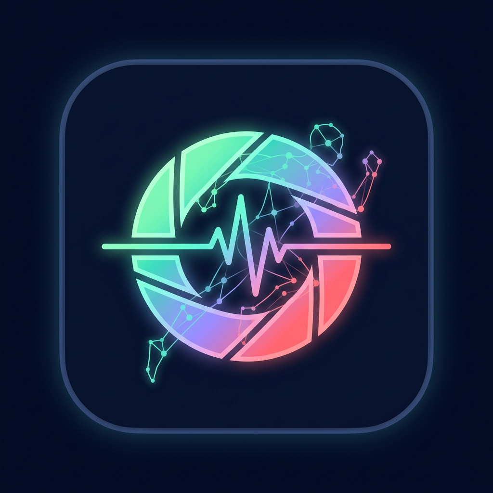

<p align="center">
  
</p>

# FitLens — Contactless Human-Sensing AI Fitness & Biomechanics Coach

FitLens is a real-time Android fitness and biomechanics coach built with the **Presage SmartSpectra Android SDK** and **Google ADK Kotlin**. Using a single camera stream without wearables or chest straps, FitLens responds live to **pulse rate**, **breathing rate**, **HRV (RMSSD)**, and **facial expressions**—adapting rest intervals, pacing recovery breathing, and coaching facial tension release through face and chest tracking.

> **Wellness & Fitness Disclaimer**: FitLens is strictly a non-medical fitness, exercise form, and wellness biofeedback application. It is **not a medical device** and does not diagnose, treat, cure, or prevent any disease or support medical decision-making.

---

## 🌟 Real-Time Response to Live Presage SmartSpectra Signals

FitLens owns a single CameraX pipeline through [`DualStreamAnalyzer`](app/src/main/kotlin/com/fitlens/app/camera/DualStreamAnalyzer.kt) and feeds frames headlessly via `SmartSpectraSdk.shared.useCustomInput()`.

| Live SmartSpectra Signal | SDK Metric Group | Real-Time FitLens Experience Response |
|---|---|---|
| **Pulse Rate & Relative Arterial Pressure Trace** | `SmartSpectraConfig.cardioMetrics` | Classifies live exertion across **5 personalized Karvonen Heart Rate Reserve (HRR)** zones ([`UserProfile`](app/src/main/kotlin/com/fitlens/app/data/profile/UserProfile.kt)), dynamically extends inter-set recovery (`+15s` / `+30s`) via [`calculateAdaptiveRest`](app/src/main/kotlin/com/fitlens/app/ai/FitnessTools.kt) when HR remains elevated, renders a live pulse waveform, and measures **HR Recovery Drop** during cooldown. |
| **Breathing Rate & Chest / Abdomen Traces** | `SmartSpectraConfig.breathingMetrics` | Triggers an **Animated Coherent Recovery Breathing Pacer** (`4s Inhale / 6s Exhale` expanding ring) in [`WorkoutVisualPlayer`](app/src/main/kotlin/com/fitlens/app/ui/WorkoutVisualPlayer.kt) during rest intervals and cooldown whenever respiratory rate rises (`≥ 21 brpm`), guiding athletes back toward calm nasal breathing. |
| **Heart Rate Variability (HRV RMSSD)** | `SmartSpectraConfig.cardioMetrics` | Surfaces a live **Autonomic Readiness & Exertion Load** badge (`High Readiness`, `Balanced Load`, `High Exertion Load`) in the HUD and longitudinal readiness scoring. |
| **Facial Expressions** | `MetricType.EXPRESSIONS` | Detects facial grimace/tension (`Angry`, `Fear`, `Disgust`, `Sad`, `Strain`) vs. composed effort (`Happy`, `Neutral`) via [`evaluateHolisticBiofeedback`](app/src/main/kotlin/com/fitlens/app/ai/FitnessTools.kt), coaching athletes to unclench their jaw, drop their shoulders, and exhale through sticking points. |
| **Validation Status & On-Demand Insights** | `sdk.validationStatus` & `sdk.insight` | Displays live framing/lighting hints directly in the dashboard and workout HUD, and triggers natural-language wellness summaries via `sdk.requestInsight(...)`. |

---

## 🔐 Consent, Privacy & Responsible Data Handling

- **Explicit Pre-Capture Camera Consent**: Camera preview and SmartSpectra frame processing remain **completely disabled** until the user reviews and accepts [`SensingConsentDialog`](app/src/main/kotlin/com/fitlens/app/ui/ConsentAndPrivacySheet.kt). Consent can be revoked anytime in **Profile, Zones & Privacy**.
- **Volatile In-Memory Video Processing**: Camera frames (`YUV_420_888`) are processed strictly in volatile RAM on-device by SmartSpectra and immediately closed. Video frames are **never** written to disk or transmitted over the network.
- **100% Local SQLite Health Vault (`fitlens_health_sqlite.db`)**:
  - Session summaries (`workout_sessions`) and vitals telemetry (`local_vitals_telemetry`) are stored strictly locally via Room/SQLite—zero cloud health sync.
  - **User Retention, Export & One-Tap Deletion**: Data remains on-device under user control. Users can export their vault to local JSON ([`LocalDataExportManager`](app/src/main/kotlin/com/fitlens/app/data/LocalDataExportManager.kt)) or permanently wipe all stored records in one tap (**Clear Local Data** in [`ProfileAndPrivacySheet`](app/src/main/kotlin/com/fitlens/app/ui/ConsentAndPrivacySheet.kt)).
- **Presage SmartSpectra Network Gating & Telemetry Opt-Out**:
  - All physiological signal extraction runs **on-device** inside the SmartSpectra SDK. Network calls to Presage are used only for API key authentication and subscription gating.
  - SmartSpectra's optional aggregate per-session diagnostic telemetry (which contains **no raw video frames, no vital sign values, and no user or device identifiers**) is transparently disclosed and can be toggled off (`sdk.config.enableTelemetry = false`) in [`ConsentAndPrivacySheet`](app/src/main/kotlin/com/fitlens/app/ui/ConsentAndPrivacySheet.kt).
- **Zero Client AI Keys & 100% Offline Edge AI Option**:
  - Biometric vitals are **never** sent to cloud AI services.
  - Optional workout routine and 4-week mesocycle generation uses **Firebase AI Logic + App Check** (zero `GEMINI_API_KEY` in source or APK, sending only non-biometric preferences: goal, experience, equipment, duration), or can be locked to **100% Offline On-Device Edge AI** ([`LocalEdgeEngine`](app/src/main/kotlin/com/fitlens/app/ai/adk/LocalEdgeEngine.kt)).

---

## 🏗️ Architecture Overview

1. **Presentation Layer (Jetpack Compose & Material 3)**:
   - [`MainActivity`](app/src/main/kotlin/com/fitlens/app/MainActivity.kt): Single-activity host coordinating explicit sensing consent, runtime permissions, and the unified CameraX + SmartSpectra + Gemini Live pipeline via [`WorkoutViewModel`](app/src/main/kotlin/com/fitlens/app/ui/WorkoutViewModel.kt).
  - [`PersonalTrainerScreen`](app/src/main/kotlin/com/fitlens/app/ui/PersonalTrainerScreen.kt): Unified 3-tab interface (**Train**, **Vitals**, **Coach**) with persistent PiP / Full / Hidden CameraX preview, real-time SmartSpectra biometrics & PPG/respiratory waveforms, workout program customizer, Gemini Live voice/text coaching, and compact bottom vitals strip.
  - [`WorkoutVisualPlayer`](app/src/main/kotlin/com/fitlens/app/ui/WorkoutVisualPlayer.kt): Interactive active-workout stage with rep/hold progress, TTS voice coaching ([`FitLensAudioCoach`](app/src/main/kotlin/com/fitlens/app/audio/FitLensAudioCoach.kt)), and the **SmartSpectra Coherent Recovery Breathing Pacer**.
  - [`ConsentAndPrivacySheet`](app/src/main/kotlin/com/fitlens/app/ui/ConsentAndPrivacySheet.kt): Explicit pre-capture consent dialog, personalized Karvonen HRR profile settings, SmartSpectra telemetry & Offline Edge AI toggles, Day 1 Hard Gate smoke test runner, and one-tap local data deletion.
2. **Sensing Intelligence**:
  - [`PresageFrameAnalyzer`](app/src/main/kotlin/com/fitlens/app/vitals/PresageFrameAnalyzer.kt) & [`PresageManager`](app/src/main/kotlin/com/fitlens/app/vitals/PresageManager.kt): Headless `CustomInput` frame ingestion, Karvonen HRR classification, and runtime telemetry configuration.
3. **Workout & ADK Coaching Engine**:
  - [`WorkoutManager`](app/src/main/kotlin/com/fitlens/app/workout/WorkoutManager.kt): State machine (`IDLE` ➔ `WARMUP` ➔ `ACTIVE_SET` ⇄ `REST_INTERVAL` ➔ `COOLDOWN` ➔ `COMPLETED`) supporting multi-exercise routines, timed isometric Plank holds, and vitals-guided adaptive rest.
   - [`FitnessCoachAgent`](app/src/main/kotlin/com/fitlens/app/ai/FitnessCoachAgent.kt), [`FitnessTools`](app/src/main/kotlin/com/fitlens/app/ai/FitnessTools.kt), & [`LocalEdgeEngine`](app/src/main/kotlin/com/fitlens/app/ai/adk/LocalEdgeEngine.kt): Hybrid Cloud + deterministic sub-10ms On-Device Edge `@Tool` dispatcher.

---

## 🛠️ Setup & Testing Instructions (For Judges & Developers)

### Prerequisites
- **Android Studio Ladybug (2024.2+)** or **JDK 17** with **Android SDK Platform 36**
- An Android phone running **Android 9.0+ (API 28+, ARM64/ARM32)** for live camera rPPG + face/chest sensing *(or an emulator using the built-in Headless Smoke Test & Live Simulation Controls — no login credentials required!)*

### 1. Clone the Repository
```bash
git clone https://github.com/Tech-Vexy/FitLens.git
cd FitLens
```

### 2. Add Your Presage SmartSpectra API Key
1. Register for a free Presage developer key at [physiology.presagetech.com/auth/register](https://physiology.presagetech.com/auth/register).
2. Create a git-ignored `secrets.properties` file in the project root:
   ```properties
   PRESAGE_API_KEY=your_presage_smartspectra_api_key
   ```
   *(If `secrets.properties` is omitted, Gradle falls back to `local.defaults.properties` so the project still builds cleanly and all simulation / automated smoke-test features remain testable.)*

### 3. (Optional) Firebase AI Logic Configuration
- To enable cloud Gemini routine generation via Firebase App Check, place `app/google-services.json` from Firebase Console.
- **Zero-setup fallback**: If `app/google-services.json` is omitted or the device is offline, `FitnessCoachAgent` automatically routes all workout plans and 4-week mesocycles locally via [`LocalEdgeEngine`](app/src/main/kotlin/com/fitlens/app/ai/adk/LocalEdgeEngine.kt).

### 4. Run Automated Architecture & Unit Verification
```bash
./scripts/verify_fitlens.sh
```

### 5. Build & Install Debug APK
```bash
./gradlew installDebug
```

---

## 📄 Submission & Verification Docs
- [**Official DEV Challenge Submission Post Draft (`docs/DEV_SUBMISSION_POST.md`)**](docs/DEV_SUBMISSION_POST.md)
- [**Judge Demo Walkthrough & Pitch Guide (`docs/COMPETITION_SUBMISSION_GUIDE.md`)**](docs/COMPETITION_SUBMISSION_GUIDE.md)
- [**Day 1 Hard Gate Verification Runbook (`docs/DAY_1_HARD_GATE_RUNBOOK.md`)**](docs/DAY_1_HARD_GATE_RUNBOOK.md)
